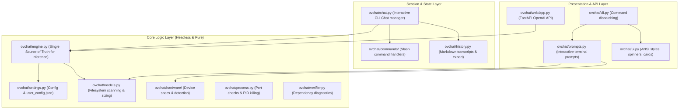

# Agent Development Guidelines for `ovchat`

This guide instructs AI coding agents on the architecture, layer boundaries, and coding standards of the **`ovchat`** codebase. **All future code modifications and feature additions MUST adhere to these architectural rules.**

---

## 1. Architecture Overview & Layer Boundaries

The codebase follows a strict **Layered Architecture**. Dependencies flow in one direction: from Presentation $\longrightarrow$ Core Logic.



---

## 2. Strict Architectural Rules for Agents

### Rule 1: The Unified Inference Engine is the Single Source of Truth
- **File**: [`ovchat/engine.py`](file:///d:/projects/my%20ov%20script/ovchat/engine.py) (`InferenceEngine`)
- **NEVER** re-implement OpenVINO pipeline compilation, MoE offloading logic, or Heterogeneous Execution properties in any other module (such as `web/app.py` or `chat.py`).
- All execution devices (`GPU`, `HETERO:GPU,CPU`, `CPU`), pipeline classes (`VLMPipeline` vs `LLMPipeline`), and hardware properties (`MODEL_DISTRIBUTION_POLICY`, `OFFLOAD_RATIO`, `ENABLE_MMAP`) **MUST** be configured exclusively inside `InferenceEngine`.
- Both the terminal CLI (`Chat`) and the web server (`app.py`) must delegate model loading and generation directly to `InferenceEngine`.

### Rule 2: No UI, ANSI, or `input()` in Core Modules
- **Core Modules**: `ovchat/engine.py`, `ovchat/models.py`, `ovchat/hardware/`, `ovchat/settings.py`, `ovchat/process.py`.
- **Constraint**: These modules must remain **completely headless**.
  - **DO NOT** use `input()` in core modules. All interactive terminal prompts belong in [`ovchat/prompts.py`](file:///d:/projects/my%20ov%20script/ovchat/prompts.py).
  - **DO NOT** embed ANSI color codes (`UI.CYAN`, `\033[...]`) inside pure data or probing functions.
  - Core functions must return raw data (dataclasses, lists, dicts, primitives), leaving formatting to `ovchat/ui.py` or `ovchat/prompts.py`.

### Rule 3: Zero Import-Time Side-Effects
- **File**: [`ovchat/__init__.py`](file:///d:/projects/my%20ov%20script/ovchat/__init__.py)
- Importing `ovchat` or any of its submodules must be instantaneous and side-effect free:
  - **DO NOT** invoke dependency checks, auto-installers (`pip install`), or terminal printing (`print()`) at the module level or during `import`.
  - Dependency verification is explicitly called in entrypoints (`ovchat.cli.entrypoint()`) or server startup hooks.

### Rule 4: Unified Configuration & Cascading Settings
- **Files**: [`ovchat/settings.py`](file:///d:/projects/my%20ov%20script/ovchat/settings.py), [`ovchat/config.py`](file:///d:/projects/my%20ov%20script/ovchat/config.py)
- Configuration always cascades in this exact order:
  $$\text{Defaults} \longrightarrow \text{user\_config.json} \longrightarrow \text{Environment Variables (OVCHAT\_*)} \longrightarrow \text{CLI Flags}$$
- Access and update persistent configuration through:
  ```python
  from ovchat.settings import load_settings, save_settings

  settings = load_settings()
  device = settings.selected_device  # or settings["selected_device"]
  settings.context_length = 32768
  save_settings(settings)
  ```

### Rule 5: Thin Entrypoint Wrappers
- The CLI dispatcher is [`ovchat.cli:entrypoint`](file:///d:/projects/my%20ov%20script/ovchat/cli.py).
- Root-level scripts ([`ovchat.py`](file:///d:/projects/my%20ov%20script/ovchat.py), [`run_server.py`](file:///d:/projects/my%20ov%20script/run_server.py), [`kill_server.py`](file:///d:/projects/my%20ov%20script/kill_server.py)) must remain **thin wrappers** delegating directly to `entrypoint()`.
- **DO NOT** duplicate custom `sys.argv` parsing loops across multiple root scripts. Add new subcommands or flags to the centralized argument parser in `ovchat/cli.py`.

---

## 3. Module Reference & Responsibilities

| Directory / File | Responsibility | Permitted Dependencies |
| :--- | :--- | :--- |
| `ovchat/engine.py` | OpenVINO GenAI runtime, pipeline compilation, token streaming, thread safety. | `metadata.py`, `config.py`, `settings.py`, `openvino`, `openvino_genai` |
| `ovchat/models.py` | Local model filesystem discovery, `.bin` weight sizing. Pure filesystem only. | `config.py`, `pathlib` |
| `ovchat/hardware/` | Device probing (GPU, CPU, NPU), specs discovery, memory polling. | `openvino`, `psutil`, `process.py` |
| `ovchat/prompts.py` | All terminal user prompts (`choose_model`, `choose_device`, `choose_integer`). | `models.py`, `hardware/`, `ui.py`, `config.py` |
| `ovchat/process.py` | Cross-platform port sniffing and process killing (`taskkill`, `SIGTERM`). | Standard library (`os`, `subprocess`, `signal`) |
| `ovchat/web/` | FastAPI server with OpenAI-compatible streaming endpoints. | `engine.py`, `settings.py`, `models.py`, `fastapi`, `pydantic` |
| `ovchat/commands/` | Terminal chat slash commands (`/image`, `/file`, `/export`, `/moe`, `/hetero`). | `base.py`, `engine.py`, `history.py`, `ui.py` |
| `ovchat/ui.py` | ANSI color palettes, terminal banners, box formatters. | Standard library |
| `ovchat/verifier.py` | Required pip package verification and optional auto-installer. | Standard library (`importlib`, `subprocess`) |

---

## 4. Intel Arc & Hardware Acceleration Standards

When adding or modifying inference configurations, adhere to these hardware rules:
1. **Intel Arc GPU**: Primary acceleration target. Configured via device string `"GPU"`.
2. **Heterogeneous Pipeline Parallelism**:
   - Device string: `HETERO:GPU,CPU` (or custom priorities like `HETERO:GPU.0,GPU.1,CPU`).
   - Distribution policy: `MODEL_DISTRIBUTION_POLICY=PIPELINE_PARALLEL`.
   - Never place `CPU` before `GPU` in priority strings.
3. **MoE Offloading (Mixture of Experts)**:
   - For MoE models (`metadata.is_moe == True`) running on GPU:
   - Properties: `OFFLOAD_RATIO = <1-99>` and `ENABLE_MMAP = "YES"`.
4. **Intel NPU Acceleration**:
   - LLMs are supported on Intel NPU via the `"NPU"` device string.
   - Vision-Language Models (VLMs) on NPU are currently undergoing verification and testing; `VLMPipeline` may require GPU/CPU fallback.
5. **Metadata Detection Precaution**:
   - Automatic metadata inspection may occasionally misread architecture flags or context limits on custom/fine-tuned checkpoints. Always allow users/callers to override context parameters and device selections.

---

## 5. Verification & Packaging Workflow

Before completing any task, agents must verify that changes do not break standalone packaging or module imports:

1. **Verify Clean Imports (No Side-Effects)**:
   ```bash
   python -c "import ovchat; print('OK:', ovchat.__version__)"
   ```
2. **Verify CLI Help & Subcommands**:
   ```bash
   python ovchat.py --help
   python ovchat.py check
   ```
3. **Rebuild the Standalone Executable**:
   Any added module or refactored import must package cleanly into the zipapp archive:
   ```bash
   python scripts/build_standalone.py
   ```
   Ensure `dist/ovchat.pyz` builds with zero errors.

